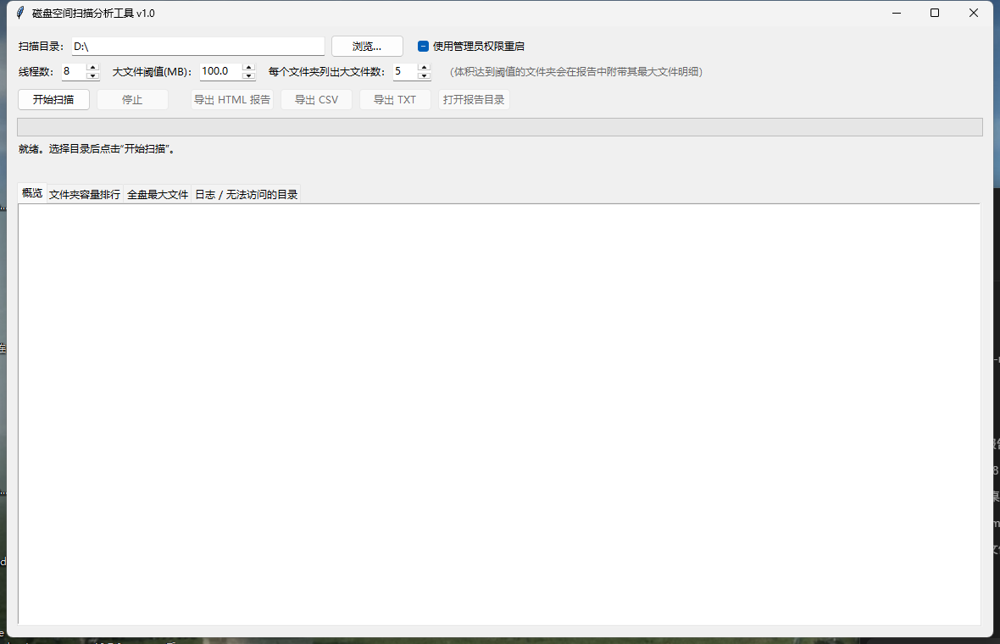

# 磁盘空间扫描分析工具（DiskReport）

一个 Windows 上的**磁盘空间扫描 + 可视化报表**小工具：扫描整个磁盘（默认 D 盘），统计**每个文件夹占用的容量**，
按占用大小**从大到小排序**，并把**每个文件夹里体积较大的文件**列出来，最后导出一份可直接用浏览器打开的报告。



## 它解决什么问题

Windows 自带的"存储设置"只能告诉你几个大类占了多少，资源管理器的"属性"又得一个一个文件夹点。
当 D 盘莫名少了 100 GB 时，这个工具几秒钟就能告诉你：**是哪几个文件夹吃掉了空间，以及具体是哪些大文件**。

## 功能特性

- **按文件夹排序**：完整统计每个文件夹（含所有子目录）的占用容量，从大到小排列，一眼看出"重灾区"
- **指出大文件**：每个文件夹里最大的若干个文件直接列在报告里，不用再一层层点进去找
- **多种输出**：自包含的 HTML 可视化报告（可排序、可搜索、可按体积筛选、可展开大文件明细）+ CSV + TXT 摘要
- **多线程扫描**：按目录并行，SSD 上全盘扫描通常只需几秒；可随时中断，已扫描的数据仍会出报告
- **只读安全**：全程只调用 `os.scandir()` / `entry.stat()` 读取目录和元数据，**不会打开、修改、移动或删除任何文件**
- **结果可靠**：跳过符号链接 / 目录联接（junction），不重复计数、不会陷入死循环；支持超过 260 字符的超长路径
- **容错**：权限不足的目录不会中断扫描，会单独列进"无法访问"清单
- **命令行模式**：可写进 bat 脚本，配合任务计划程序定时生成报告

## 快速开始

### 方式一：直接运行现成的 exe

**[:arrow_down: 下载 DiskReport.exe](https://github.com/DylanWalker933/DiskReport/releases/latest/download/DiskReport.exe)**（约 11 MB，对应 v1.0），
下载后双击即可运行，**无需安装 Python**。历史版本与校验值见 [Releases](https://github.com/DylanWalker933/DiskReport/releases) 页面。

> 程序没有购买代码签名证书，首次运行时 Windows SmartScreen 可能提示"已保护你的电脑"，
> 点 **更多信息 → 仍要运行** 即可。源码完全公开在本仓库，可自行审阅或自行打包。

### 方式二：从源码运行

只需要 Python 3.10+（含 tkinter，Windows 官方安装包默认自带），**没有任何第三方依赖**：

```bat
python DiskReport.py
```

### 方式三：自己打包成单文件 exe

```bat
pip install pyinstaller
python -m PyInstaller --noconfirm --onefile --windowed --name DiskReport DiskReport.py ^
  --icon app.ico --version-file version_info.txt
```

生成的 exe 在 `dist\DiskReport.exe`。（`DiskReport.spec` 是等价的可复现打包配置，也可以直接 `python -m PyInstaller DiskReport.spec`。）

## 使用方法

1. 双击 `DiskReport.exe` 打开界面。
2. **扫描目录**默认 `D:\`，可改成其他盘符，或点"浏览…"只扫描某个文件夹。
3. 需要时调整参数：

   | 参数 | 默认值 | 说明 |
   | --- | --- | --- |
   | 线程数 | 8 | 并行扫描的线程数，SSD 上 12～16 效果较好 |
   | 大文件阈值(MB) | 100 | 体积达到该值的文件夹会在报告中附带大文件明细 |
   | 每个文件夹列出大文件数 | 5 | 每个文件夹最多列出最大的几个文件 |

4. 点 **开始扫描**，界面实时显示已扫描的文件夹数、文件数、容量、耗时和当前路径；随时可点 **停止**。
5. 扫描完成后查看四个标签页：**概览**、**文件夹容量排行**（点表头可换排序）、**全盘最大文件**、**日志 / 无法访问的目录**。
   表格中**双击**一行可在资源管理器中打开该文件夹。
6. 点 **导出 HTML 报告 / 导出 CSV / 导出 TXT** 保存结果。

> 想扫描到 `System Volume Information`、回收站等受保护目录，可勾选左上角的
> **"使用管理员权限重启"**，以管理员身份再扫一次；扫描 C 盘时建议这样做。

## 导出的报告长什么样

HTML 报告是**单个自包含文件**（CSS/JS 全部内联，无任何外部请求），双击用浏览器打开即可：

- **总览卡片**：占用合计、文件数、文件夹数、无法访问的目录数、扫描耗时
- **一级文件夹容量排行**：带比例条的直观对比
- **文件夹容量排行**：全部文件夹按占用降序，点表头换排序字段，支持路径搜索、按体积筛选（≥1 GB / ≥10 GB …）
- **大文件明细**：点每行右侧的"查看 N 个"展开该文件夹里最大的文件（完整路径 + 大小）
- **全盘最大文件**：整个磁盘里最大的文件清单

另外还会导出 `*_文件夹排行.csv`（全量文件夹，可直接用 Excel 打开）和 `*_大文件清单.csv`。

## 报告里的数字怎么看

- 文件夹"占用空间" = 该文件夹**以及它所有子文件夹**中文件的字节数合计；单位按 1024 进制（1 GB = 1024 MB），
  因此与资源管理器的显示可能略有出入。
- 统计的是**文件大小之和**，不是磁盘实际分配空间。大量小文件在磁盘上会占用比文件大小更多的簇空间，
  所以报告的总和通常略小于"磁盘已用空间"。
- **符号链接 / 目录联接不会重复统计**，避免同一批文件被算两遍。
- `$RECYCLE.BIN` 是回收站、`System Volume Information` 是系统还原/卷影副本占用的空间，占用偏大属正常现象。

## 命令行用法

```bat
DiskReport.exe --cli --root D:\ --out D:\报告\D盘空间报告 --format all --workers 12 --big-mb 100 --files-per-dir 5
```

| 参数 | 说明 |
| --- | --- |
| `--cli` | 不打开窗口，扫描并直接生成报告 |
| `--root` | 要扫描的目录，默认 `D:\` |
| `--out` | 输出路径（可省略扩展名） |
| `--format` | `html`、`csv`、`txt`、`all`，可用逗号组合 |
| `--workers` | 线程数 |
| `--big-mb` | 大文件阈值(MB) |
| `--files-per-dir` | 每个文件夹列出的大文件数 |
| `--quiet` | 安静模式，只输出结果文件路径 |

配合任务计划程序即可每天自动生成一份报告。

## 常见问题

**扫描会改动我的文件吗？**
不会。扫描路径上只有两个只读调用：`os.scandir()`（读目录清单）和 `entry.stat()`（读文件大小与时间戳），
程序的任何代码都不会打开文件内容，也没有删除、重命名、改属性或改时间戳的逻辑。
写入只发生在你自己指定的报告输出路径上。

**为什么有的文件夹显示"无法访问"？**
多为系统保留目录（回收站、`System Volume Information` 等），普通权限读不了；勾选"使用管理员权限重启"再扫即可。

**为什么报告里的文件夹大小和资源管理器属性不一致？**
资源管理器有时不统计隐藏/系统文件、也会跟随符号链接；本工具统一按"文件夹 + 所有子文件"求和并跳过链接，以本报告为准更能反映真实占用。

**扫描要多久？**
取决于文件数量和磁盘类型。作者在 NVMe SSD 上实测：约 22 万个文件、2.5 万个文件夹，12 线程约 2 秒。
机械硬盘或海量小文件目录会慢一些，界面会实时显示进度。

**能扫描 C 盘吗？**
可以，把扫描目录改成 `C:\` 即可，但强烈建议以管理员身份运行，否则会有大量目录读不到。

**从 Release 下载 exe 很慢、或者直接失败？**
GitHub 的 Release 资产实际托管在 `release-assets.githubusercontent.com`，国内网络常常被限速或阻断，
典型表现是"仓库页面打得开、下载却卡住不动或报 TLS/EOF 错误"。可以换一个代理节点，
或在下载链接前加 GitHub 加速镜像前缀（例如 `https://ghfast.top/` + 原始链接）后再下载。
**下载完成后请用 [Release 说明](https://github.com/DylanWalker933/DiskReport/releases) 里的 SHA256 校验文件完整性。**

## 项目结构

```
DiskReport.py       # 全部源码（单文件：扫描器 + 报告生成 + Tkinter 界面）
app.ico             # 程序图标
version_info.txt    # 打包进 exe 的版本信息
DiskReport.spec     # PyInstaller 打包配置
make_icon.py        # 生成 app.ico 的脚本（需要 Pillow）
gui_selftest.py     # 界面自动化自检：无需鼠标即可跑完 扫描→填表→排序→导出
docs/screenshot.png # 界面截图
使用说明.md          # 更详细的中文使用说明
```

## 开发说明

- 单文件实现，无第三方依赖（`make_icon.py` 除外，它只在生成图标时需要 Pillow）。
- 扫描器为"一个目录一个任务"的多线程队列模型，主线程负责等待/取消，扫描结束后自底向上汇总各文件夹容量。
- 想要修改后自测，可运行界面自检脚本：

  ```bat
  python gui_selftest.py "D:\某个测试目录"
  ```

## 许可证

本项目采用 [MIT License](LICENSE) 开源，可自由使用、修改和分发。
